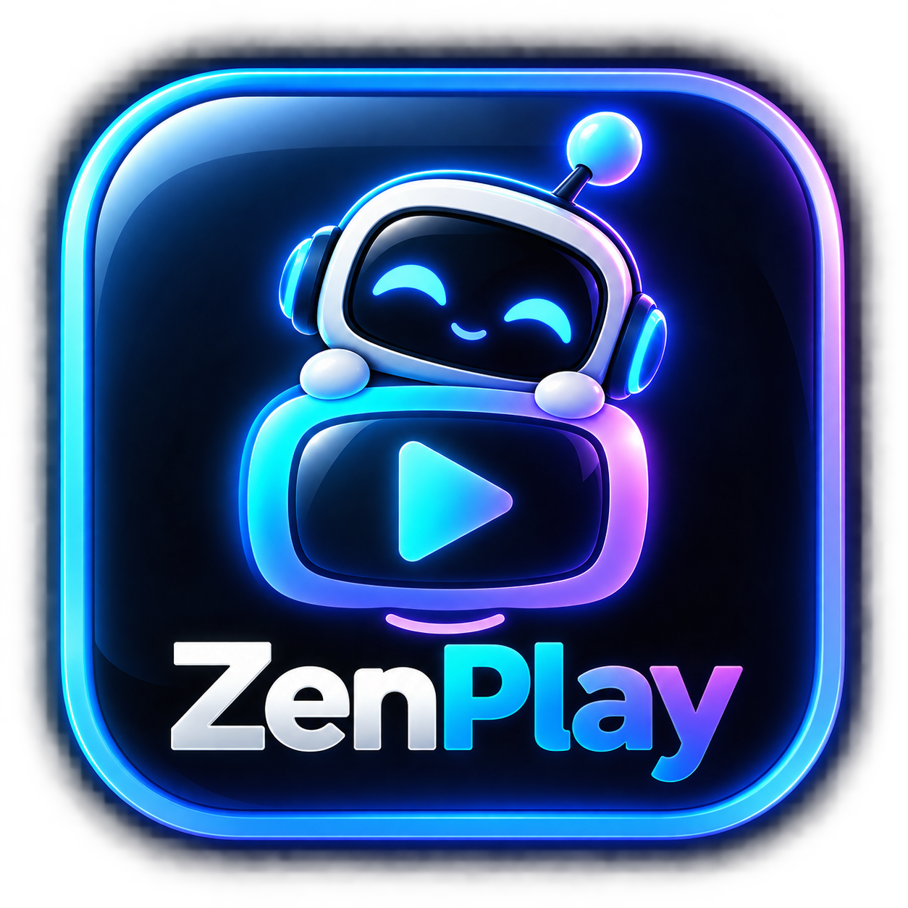

# ZenPlay para Windows y macOS

<p align="center">
  
</p>

Aplicación de escritorio de ZenPlay para televisión en vivo, películas y series.
Se instala como un programa independiente y utiliza un motor multimedia nativo
integrado para ampliar la compatibilidad de video, audio y subtítulos frente a
la versión que funciona únicamente en el navegador.

> **Estado actual:** compilación de prueba. Los paquetes disponibles todavía no
> están firmados digitalmente ni notarizados. Windows puede mostrar SmartScreen
> y macOS puede requerir abrir la aplicación mediante clic secundario → **Abrir**.

## Plataformas

- Windows x64 mediante instalador `.exe`.
- macOS 12 o posterior para equipos Intel mediante `.dmg` o `.zip`.
- macOS 12 o posterior para Apple Silicon mediante `.dmg` o `.zip`.

## Funciones principales

- Inicio de sesión con la cuenta ZenPlay.
- TV en vivo organizada por categorías.
- Catálogo de películas y series con portadas, búsqueda y detalles.
- Inicio con tendencias, contenido recién agregado y continuar viendo.
- Reproductor MPV integrado como motor principal en escritorio.
- Selección de pistas de audio y subtítulos cuando el contenido las incluye.
- Reanudación y desplazamiento por la barra de progreso en películas y episodios.
- Descargas para uso sin conexión en Windows y macOS.
- Favoritos, historial y perfiles.
- Preparada para recibir actualizaciones desde GitHub Releases.

## Instalación de las compilaciones de prueba

### Windows

1. Descarga el archivo cuyo nombre termina en `windows-x64-setup.exe`.
2. Abre el instalador y sigue las indicaciones.
3. Si aparece SmartScreen, revisa que el archivo provenga de este repositorio.

### Mac con Apple Silicon

Usa el paquete `mac-arm64.dmg`. Corresponde a los equipos con procesador Apple
M1, M2, M3, M4 o posterior.

### Mac con procesador Intel

Usa el paquete `mac-x64.dmg`.

En estas primeras compilaciones de macOS puede ser necesario hacer clic
secundario sobre ZenPlay y elegir **Abrir**. La distribución pública definitiva
deberá firmarse y notarizarse con una cuenta de Apple Developer.

## Desarrollo

Requisitos:

- Node.js 22.22.3 o 24.15.0
- pnpm 10.33.0

Comandos principales:

```shell
pnpm install
pnpm build:frontend
pnpm build:backend
pnpm make:app
```

La automatización de GitHub genera paquetes independientes para Windows x64,
macOS Intel y macOS Apple Silicon.

## Privacidad y contenido

ZenPlay es un reproductor. El acceso, disponibilidad, idioma, pistas de audio,
subtítulos y calidad dependen del contenido incluido en la cuenta del usuario y
de los permisos de su proveedor.

## Proyecto base y licencia

ZenPlay Desktop está basado en
[IPTVnator](https://github.com/4gray/iptvnator), proyecto de código abierto.
Se conserva la licencia MIT y los avisos de autoría correspondientes en
[LICENSE](./LICENSE).
